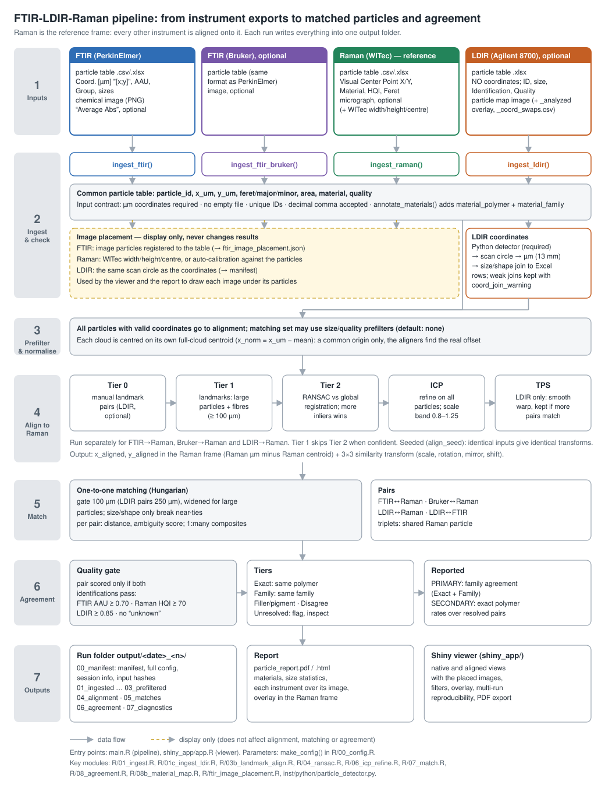

# Multi-Instrument Microplastic Particle Matching Pipeline

Spatial alignment and material cross-validation of microplastic particles detected by **FTIR** (PerkinElmer Spotlight, Bruker LUMOS), **Raman** (WITec) and **LDIR** (Agilent 8700) microspectroscopy on the same filter sample.

Version 1.0.0 · [Changelog](CHANGELOG.md) · [Validation](docs/validation.md) · [Input format](docs/input_format.md) · [Roadmap](docs/roadmap.md) · [How to cite](#citation)

## What it does

When the same filter is analysed by multiple instruments, each produces its own particle list with coordinates, sizes, and material identifications. This pipeline:

1. **Ingests** tabular data and companion images from up to four instruments (two FTIR, Raman, LDIR) into one checked particle table per instrument; any other instrument's table can be read through a column mapping
2. **Extracts spatial coordinates** for LDIR via a Python-based image processing backend (scipy/numpy sigma-clipping + auto-tuned threshold)
3. **Aligns** coordinate systems using a tiered approach (Landmark → RANSAC → ICP)
4. **Matches** particles one-to-one across instrument pairs (each instrument ↔ Raman, plus LDIR↔FTIR and Bruker↔PerkinElmer / LDIR)
5. **Identifies triplets** — particles detected by FTIR (PerkinElmer), Raman and LDIR together, with material-agreement quality scoring
6. **Compares** material identifications: family agreement (primary) and exact-polymer agreement (secondary), counting only identifications each instrument trusts; unresolvable name pairs are flagged for inspection
7. **Checks** itself: chance-match estimates, the LDIR image join against Raman, full provenance of every run
8. **Exports** matched pairs, agreement statistics, diagnostic plots, a PDF/HTML report and a Shiny viewer

## Pipeline overview



## Quick start

With the prerequisites below installed, run the bundled example (one filter
measured with all four instruments, `examples/dataset_A/`) from the
repository root:

```bash
Rscript examples/run_example_A.R        # results in output/<date>_<n>/
```

It takes about 1–2 minutes. Open the results with the viewer
(`shiny::runApp("shiny_app")`).

### Prerequisites

**R (≥ 4.1)** — the code uses the native `|>` pipe. Install the full package set:
```r
install.packages(c(
  "base64enc", "clue", "ggplot2", "ggrepel", "gridExtra", "gtable", "jpeg",
  "jsonlite", "magick", "plotly", "png", "RANN", "readxl", "reticulate",
  "rintrojs", "shiny", "shinyFiles", "zip"
))
```
(`DESCRIPTION` is the authoritative list.)

**Python 3** is **required for LDIR image analysis** (FTIR/Raman-only runs do not need it):
```bash
pip install -r inst/python/requirements.txt    # numpy, scipy, Pillow
```

The Python backend is called through `reticulate`. There is no R fallback: if
Python or one of its packages is missing, the run stops before the LDIR image
step and says what is missing. Nothing is installed automatically. To pin a
specific interpreter, set `RETICULATE_PYTHON` (e.g. in `~/.Renviron`) before
launching R; otherwise a standard Windows install or `python3`/`python` on
`PATH` is used.

#### Reproducible environment

`DESCRIPTION` declares the dependencies and `renv.lock` records the versions
used. To install exactly those versions with [`renv`](https://rstudio.github.io/renv/):
```r
install.packages("renv")
renv::restore()
```

### Running the pipeline

**Any two or more instruments** can be combined (Raman, FTIR PerkinElmer,
FTIR Bruker, LDIR). The shared frame is Raman when it is present, else FTIR
(PerkinElmer), else FTIR (Bruker); every other instrument is aligned into it
and every pair of instruments is matched. LDIR is never the frame (its
coordinates usually come from its image), so LDIR needs Raman or an FTIR.

**Option A — File pickers** (default): `source("main.R")` opens one file
dialog per instrument slot; cancel a slot to skip it. At least two data files
are needed.

**Option B — Paths in a script** (non-interactive):

```r
input_mode <- "hardcoded"
ftir_file  <- "Comparstic Spotlight F2Ba Au 240926.csv"
raman_file <- "Comparstic Raman F2Ba Au IAEA 240930.csv"
ldir_file  <- "Comparstic LDIR F2Ba Au MP2 240925.xlsx"          # optional
ftir_image <- "Average Abs.( Comparstic Spotlight F2Ba Au 240926 ).png"  # optional
ldir_image <- "LDIR_particle_map.png"                             # optional
config_overrides <- list(match_dist_threshold_um = 80)            # optional
source("main.R")
```

Leave out any instrument (`raman_file <- NULL`, …) as long as two remain.
`examples/run_example_A.R` is a complete example of this.

**Option C — As a function**:

```r
source("R/load.R"); load_pipeline()
config <- make_config(ftir_path = "ftir.csv", raman_path = "raman.csv",
                      output_dir = "output")
config$ldir_path  <- "ldir.xlsx"
config$ldir_image <- "ldir.png"
result <- run_pipeline(config)   # every output also goes to the run folder
```

Results are written to a timestamped subfolder under `output/` (e.g. `output/2026-02-19_1/`).

## Input data formats

| Instrument | Format | Key columns |
|------------|--------|-------------|
| **FTIR** (PerkinElmer Spotlight) | CSV (comma-separated) | `Coord. [um]` (bracketed X;Y), `Group` (material), `Max AAU score` |
| **Raman** (WITec) | CSV (semicolon-separated) | `Visual Center Point X/Y [um]`, `Material`, `HQI`, `Feret Max [um]` |
| **LDIR** (Agilent 8700) | XLSX | `Identification` (material), `Quality`, `Width/Height [um]` — **no X/Y coordinates** |
| **FTIR image** | PNG | Chemical absorption map exported from the FTIR instrument |
| **LDIR image** | PNG | Colored particle map exported from Agilent LDIR software |

The ingest module auto-detects CSV delimiters and handles encoding differences (Latin-1, UTF-8).

**Segmented PerkinElmer exports.** The current Spotlight software exports a
whole-filter scan as six segments (`…M1.csv` … `…M6.csv` and
`…_M1.bmp` … `…_M6.bmp`), each in its own coordinate frame. Select any one
segment table as the FTIR file and any one segment image as the FTIR image
(the tables and images may be in different folders): the pipeline finds the
other segments, stitches them (2 x 3 grid filled column by column, 2 µm per
pixel) into `inputs/ftir_stitched/` of the run, checks that the particles
land on particles in the stitched image, and continues with the stitched
table and image, placed exactly. A segment without particles may have no
table; all six images are needed. `Rscript tools/stitch_ftir_segments.R
<folder> [output folder]` does the same on its own. The stitched image's
placement is written next to it (`<name>_stitched.txt`); the pipeline reads
such a file for any FTIR image unless `ftir_image_width_um` / `_height_um` are
set in the config. This is a workaround until the software exports one file
per scan. The grid (2 x 3, filled
column by column) and the image scale (2 µm per pixel) are those of the
current exports.

Tables in any other layout are read with the column-mapping reader: name, in
an R list or a JSON file, which column holds each field and the units
(`config$<role>_column_map`). Every reader returns the same canonical particle
table, which is checked before the pipeline continues. Instrument labels the
material rules do not know can be translated per instrument in
`inst/materials/<role>.csv`. See [docs/input_format.md](docs/input_format.md).

## Pipeline architecture

```
main.R                          # File input + config, then run_pipeline(config)
R/
  00_config.R                   # All tunable parameters
  00b_file_input.R              # Interactive file picker
  particle_contract.R           # Canonical particle table / image object + validators
  01_readers.R                  # read_instrument(): reader per role, column-mapping reader, material tables
  01_ingest.R                   # FTIR + Raman CSV/Excel parsing
  01b_ingest_image.R            # Connected-component helpers for image segmentation
  01c_ingest_ldir.R             # LDIR Excel parsing + image coordinate extraction
  02_prefilter.R                # Quality/size pre-filtering
  03_normalize.R                # Coordinate centering
  03b_landmark_align.R          # Tier 1: large-particle landmark alignment
  04_ransac.R                   # Tier 2: RANSAC with rotation grid search
  05_transform.R                # Affine transform helpers
  06_icp_refine.R               # Iterative Closest Point refinement
  07_match.R                    # Nearest-neighbor spatial matching
  08_agreement.R                # Material agreement scoring
  08b_material_map.R            # Polymer family classification & equivalence mapping
  09_diagnostics.R              # Overlay plots, histograms, confusion matrix
  10_export.R                   # CSV/PDF/TXT export
  load.R                        # load_pipeline(): packages + modules
  ldir_join_check.R             # LDIR image join checked against Raman
  measure_raman_placement.R     # Raman image placement (WITec file, auto-calibration)
  align_and_match.R             # Reference frame (Raman, else FTIR); align + match + agreement per pair; triplets
  ldir_stage.R                  # LDIR: image coordinates, alignment, matching
  run_pipeline.R                # run_pipeline(config): the whole run as one function
  utils.R                       # Logging, geometry, transform utilities
  utils_python.R                # Reticulate bridge for Python LDIR detector
inst/
  python/
    particle_detector.py        # Python LDIR particle detection backend (+ its tests)
  materials/                    # Per-instrument material tables (user-extendable)
shiny_app/
  app.R                         # Interactive viewer
  global.R                      # Data loading for Shiny
tools/
  validation.R                  # Null model, sensitivity sweeps (docs/validation.md)
  material_vocabulary.R         # How each material label of a run was classified
  regression_fingerprint.R      # Compact summary of a run (regression test)
  stitch_ftir_segments.R        # Join segmented PerkinElmer exports on their own (temporary)
examples/
  dataset_A/                    # One filter, all four instruments
  run_example_A.R, validate_example_A.R
```

### Alignment strategy (FTIR ↔ Raman)

The coordinate systems from FTIR and Raman differ in origin, rotation (often ~180°), and sometimes scale. The pipeline finds the spatial transform in three tiers:

Landmark alignment (Tier 1) is purely **geometric**. The fallback (Tier 2) aligns on the plastics that pass each instrument's quality cutoff: on a field sample (12 000+ Raman particles on one filter) every particle has a chance partner within the inlier distance, so a purely geometric search cannot tell poses apart. Material decides only where the instruments sit relative to each other; which particles are compared, and how they agree, is decided afterwards on all particles that pass the quality cutoff.

1. **Tier 1 — Landmarks**: Particles ≥ 100 µm and fibers (aspect ratio ≥ 3) are matched between instruments. If no particle clears 100 µm, the 12 largest (≥ 30 µm) are used instead — landmarks are conspicuous *relative to the sample*, which matters on field samples where nothing is 100 µm. If enough landmarks agree (≥ 5 one-to-one landmark pairs, residual < 50 µm, and far more pairs than chance at the landmark density, Poisson p < 10⁻⁸), Tier 2 is skipped. The share of landmarks that pair is not used: on field samples each instrument finds many landmarks the other does not, and a handful of landmarks against a dense reference pair well at random. A Tier 2 pose counts as determined only when, after ICP, more anchors pair within the match gate than the pose search finds by chance (p < 0.01, `align_determined_p`); otherwise the instrument's pairs are written but not scored, and pairs through it are skipped.

2. **Tier 2 — RANSAC + global registration**: Two aligners run and the one giving more one-to-one pairs wins. The coarse RANSAC does a rotation grid search (1° steps, including mirror check) and refines a similarity transform. Global registration sweeps rotation × scale and recovers translation by voting over all pairwise offsets, scoring one-to-one — more robust when the two clouds overlap only partially. Scales are searched within 0.8–1.25 only (`align_scale_min/_max`, the band ICP enforces): every instrument reports micrometres.

3. **ICP refinement**: Iterative Closest Point polishes the transform using all particles ≥ 20 µm, with reciprocal nearest-neighbour filtering and 10% trimming of worst pairs.

The same RANSAC + ICP pipeline is applied separately to align **LDIR → Raman**.
Without Raman the same steps align every instrument to FTIR (PerkinElmer),
else FTIR (Bruker); the Raman-only alignment filters (`align_raman_min_size_um`,
the HQI filter on anchors) then do not apply.

Tier 2 anchors (`align_anchor_plastics = TRUE`): plastics (synthetic polymer families) passing the instrument's quality cutoff; with fewer than `align_min_anchor_count`, all quality-passing particles, then all. `align_ftir_materials` / `align_raman_materials` / `align_ldir_materials` set explicit anchor polymers instead (e.g. PET and PP on spiked lab samples).

### Matching

Only particles that pass their instrument's quality cutoff are paired (FTIR
AAU ≥ 0.70, Raman HQI ≥ 70, LDIR ≥ 0.85, the cutoffs of the agreement
scoring; `match_quality_filter`). The others are never scored, and on dense
field samples they only add chance partners; they stay in the aligned tables
and the viewer. Particles are paired one-to-one (Hungarian algorithm) within
a distance gate (50 µm, 20 µm for LDIR; against the reference, LDIR always and
the other instruments when 50 µm would let in more than 20% chance pairs take
3σ of the positional error fitted to that run's alignment, 10–50 µm; wider for large
particles: 0.15 × major axis), minimising the summed cost. The
cost is the centre-to-centre distance in µm plus small unitless size and
shape terms, 0.3·|ln(area ratio)| + 0.3·|ln(Feret ratio)| + 0.1·(relative
aspect-ratio difference). These add less than 1.5 µm even for a tenfold size
difference, so **matching is effectively by distance**: size and shape only
decide between candidates whose distances differ by about a micrometre.

Every run estimates, for every instrument pair, how many of its pairs a
random arrangement would also give (reference density within the gate;
logged, `07_diagnostics/chance_pairs.csv`, WARN above 20%). On a dense field
sample this tells whether the pairs can be interpreted at all.

### LDIR coordinate extraction

Since the Agilent 8700 LDIR does not export particle coordinates, the pipeline extracts them from the companion PNG image:

**Detection (Python, required)**:
- Per-tile iterative sigma-clipping background correction (4×4 grid, scipy Gaussian)
- Global thresholding after background subtraction (not per-tile, because ~3% of particles span tile boundaries)
- Auto-tuned threshold — binary search to match the expected count from the Excel file

The detected blobs are then paired with the Excel rows by size and shape
(the Excel has no coordinates). By default every Excel row receives a
position; a row whose pairing cost exceeds `ldir_match_threshold` keeps its
position but carries a join warning (see the agreement outputs). A "join rate"
is therefore 100 % by construction and says nothing about join correctness.

When the LDIR software's processed overlay (`<image>_analyzed.<ext>`) is
present, its coloured blobs are segmented in R instead (the machine's own
segmentation), and its scale is calibrated so the blob areas sum to the Excel
areas. Python is required for every LDIR image run.

Pixel centroids are mapped to µm with the image's placement (scan circle =
scan diameter, or the calibrated overlay), recorded per run in
`00_manifest/images.json`. Manual corrections of the join can be given in a
`*coord*swap*.csv` file next to the LDIR Excel.

**Join check.** After alignment, each run compares what the LDIR table says
about each particle (size, family) with what Raman found at the same place,
against a random re-assignment of the LDIR rows, and logs the result (WARN
when it is no better than random; `07_diagnostics/ldir_join_check.csv`).
On a single-polymer sample only the size statistic is informative.

### Raman particle filtering by pipeline step

| Step | Size filter | Material filter | HQI filter |
|------|-------------|-----------------|------------|
| Spatial transform (landmarks, ICP) | ≥ 20 µm | none | none |
| Tier 2 alignment anchors | ≥ 20 µm | none (optional: e.g. PET / PP if ≥ 4 available) | ≥ 70 if ≥ 4 available, else none |
| Spatial matching | ≥ 20 µm; partners differ ≤ 5× in Feret max | none | ≥ 70 |
| Agreement scoring | all | none | ≥ 70 |

### Three-way triplets

Particles matched by all three instruments are identified by finding the intersection of FTIR↔Raman pairs and LDIR↔Raman pairs that share the same Raman particle ID. Each triplet includes:

- `n_instruments_scored`: sides that pass their agreement quality cutoff and have an identification (0–3)
- `n_instrument_agreement`: count of pairwise family agreements among scored sides (0–3)
- `material_consensus`: "Full agreement", "FTIR+Raman agree", ..., "No agreement", or "Not scored" when fewer than two sides are scored
- `ftir_family`, `raman_family`, `ldir_family` and each side's quality
- `direct_ldir_ftir_match`: whether the triplet's LDIR and FTIR particles are also each other's direct match (FALSE flags a triplet linked only through the Raman particle)

Triplets need Raman, FTIR (PerkinElmer) and LDIR in the run.

## Output files

Each run creates a folder under `output/` (e.g. `output/2026-02-19_1/`).
Pair names: `ftir_perkin`, `ftir_bruker`, `raman`, `ldir`.

| Folder / file | Content |
|---|---|
| `00_manifest/manifest.json` | Run ID, git commit, input files with MD5, image assets, stage |
| `00_manifest/config_full.json`, `session_info.txt` | Every parameter as run; R and package versions |
| `00_manifest/images.json` | Placement of every image (pixel size, origin, extent, how it was obtained) |
| `01_ingested/<instrument>_ingested.csv` | Canonical particle table per instrument, as read |
| `02_joined/ldir_joined_raw.csv`, `ldir_image_extracted.csv`, `ldir_coord_quality.csv` | LDIR: image blobs, the joined table, per-particle join cost |
| `03_prefiltered/<instrument>_prefiltered.csv` | After the coordinate / size / quality prefilter |
| `04_alignment/transform_params_<pair>.txt` | Transform into the shared frame (scale, rotation, translation, 3×3 matrix, ICP) |
| `04_alignment/aligned_<instrument>.csv` | Every particle of the instrument in the shared frame (`x_aligned`, `y_aligned`) |
| `05_matches/matched_<a>_<b>.csv` | Matched pairs, both particles' columns and the distance |
| `05_matches/unmatched_<a>_vs_<b>.csv` | Particles without a partner |
| `05_matches/triplets_3way.csv`, `composite_matches.csv` | Three-way matches; 1:many FTIR→Raman fragments |
| `06_agreement/agreement_pairwise_<pair>.csv` | One row per scored pair: tier, exact polymers, families, LDIR join warning |
| `06_agreement/agreement_by_material_<pair>.csv`, `agreement_by_category.csv`, `agreement_summary.csv` | Counts and rates per material / category |
| `07_diagnostics/match_statistics.txt`, `triage_top_pairs.csv`, `tps_*` | Match statistics, pairs to review first, distortion check — for the run's main pair: FTIR (PerkinElmer), else FTIR (Bruker), else LDIR, with the reference |
| `07_diagnostics/ldir_join_check.csv`, `ldir_join_pairs.csv` | LDIR join check |
| `07_diagnostics/chance_pairs.csv` | Per pair: chance pairs expected, positional error sigma, whether the alignment is determined |
| `07_diagnostics/detection_rates.csv` | Per pair and direction, by size class, with 95% intervals: share of one instrument's particles the other *identified* (paired with a particle passing its quality cutoff) and *detected* (any particle within the gate, chance-corrected) |
| `07_diagnostics/plots/` | Overlays, confusion matrices, distance histogram, ICP convergence, residuals; `all_diagnostics.pdf` |
| `inputs/` | The run's images (copied; downsized above `raman_image_max_px`), previews |
| `particle_report.pdf`, `particle_report.html` | Report (same pages as the viewer's) |

## Shiny viewer

Launch the interactive viewer after running the pipeline:
```r
shiny::runApp("shiny_app/")
```

The viewer includes:
- **FTIR tab**: Native coordinate view with chemical absorption image overlay
- **Raman tab**: Native coordinate view
- **LDIR tab**: Native coordinate view with raw / processed / extracted-points image layers
- **Overlay tab**: All instruments in the shared coordinate frame, with layers for individual instruments, matched pairs, and triple matches (gold rings). The Raman image is the background when the run has Raman; runs without Raman have no overlay background yet
- **Precision tab**: results of a precision study (below)

### Precision study (repeatability and reproducibility)

The same filter measured several times on each instrument, e.g. 3 replicates
on each of the four: `Rscript tools/precision_study.R design.csv`, where
`design.csv` lists one measurement per row:

```
instrument,replicate,file
ftir,1,C:/data/filterA_perkin_run1.csv
ftir,2,C:/data/filterA_perkin_run2.csv
raman,1,C:/data/filterA_raman_run1.csv
...
```

(`ftir` = PerkinElmer, `ftir_bruker`, `raman`, `ldir`; for a segmented
PerkinElmer scan any one segment table; without arguments the script asks for
the files.) The measurand is the particle count per filter, per polymer family
and size class, counted as in the pipeline (≥ 20 µm; polymer groups only
particles passing the instrument's quality cutoff). No particle is matched
between measurements, so remounted, rotated filters and field samples need no
images. Following ISO 5725-2, with the instruments as the "laboratories": the
repeatability SD s_r, between-instrument SD s_L and reproducibility SD s_R
(with 95% intervals), the limits r and R, the CVs, Mandel's h and k with their
indicator levels, and each instrument's replicate variance against Poisson
counting noise. Output in `output/precision/<timestamp>/`: CSVs and
`precision_report.pdf`; the viewer's **Precision** tab reads the same folder.

### PDF report

The **Summary** tab has a **Download PDF report** button that writes one
multi-page PDF containing:

| Page | Content |
|---|---|
| 1 | Title page — run ID, generation timestamp, particle scope, per-instrument counts |
| 2 | Material comparison bar chart for the selected family |
| 3 | Plastics by Instrument (family × device counts, with totals) |
| 4 | Material breakdown pie charts, 2×2 |
| 5 | Size distributions per instrument |
| 6 | Size statistics table |
| 7+ | Each instrument view — image with its particles overlaid (FTIR PerkinElmer, FTIR Bruker, Raman, LDIR) |
| last | Overlay — all instruments in the shared frame |

The report is a **snapshot of what the viewer is currently showing**: the
Summary tab's scope toggle, the quality / size / material / match filters set on
each instrument tab, the pie display modes and the view rotations. Every figure
carries a caption recording the filters behind it, so a page lifted out of the
PDF still says what it is showing. Instruments with no data loaded are skipped.

Defaults are deliberately **inclusive**, so an untouched viewer reports the
whole population:

| Control | Default | Effect |
|---|---|---|
| Summary → *Particles included* | All particles in the run | Summary panels ignore the per-tab filters |
| Each instrument tab → *Show all detected (ignore match status)* | **on** | Every detected particle is shown, matched or not, drawn in one colour |
| Summary → material breakdown scope | **All particles** | Pies include non-plastics and unknowns, so the per-pie *n* equals the instrument's particle count |

Untick *Show all detected* on a tab to colour its points by match status and
honour that tab's Match Status boxes; switch the breakdown to *Plastics only* to
restrict the pies to synthetic (± semi-synthetic) families.

Figures are the same ggplot objects the app renders and the tables come from the
same builders as the on-screen HTML (`report_plastics_table()` /
`report_size_stats_table()` in `shiny_app/global.R`), so the report cannot drift
from the viewer. Output is written with `grDevices::cairo_pdf()` — no pandoc or
LaTeX needed.

## Configuration

All parameters are in `R/00_config.R` (`make_config()`); every run records the
full set in `00_manifest/config_full.json`. Key settings:

```r
# Alignment anchors — off by default: alignment is purely geometric. On spiked
# lab samples they can narrow the Tier 2 anchor set to polymers every
# instrument identifies reliably; a filter is honoured only while it leaves
# >= align_min_anchor_count particles.
align_ftir_materials      = NULL   # e.g. c("PET", "Polypro") for spiked samples
align_raman_materials     = NULL   # e.g. c("Polyethylene terephtalate", "Polypropylene")
align_ldir_materials      = NULL
align_min_anchor_count    = 4      # below this, the material filter is dropped
align_raman_min_size_um   = 20     # Raman particles below this are excluded from alignment

# Quality thresholds
raman_hqi_threshold       = 70     # HQI cutoff for material agreement scoring
ftir_agreement_min_quality = 0.70  # FTIR AAU cutoff for agreement scoring
ldir_hqi_unknown_threshold = 0.85  # LDIR quality below this -> "unknown"
ldir_quality_threshold    = 0      # LDIR prefilter (0 = keep all)

# LDIR scan geometry — CRITICAL: must match actual scan area
ldir_scan_diameter_um     = 13000  # Physical extent of the LDIR scan area (µm)
                                   # Increase/decrease if ICP RMS > 100 µm in log

# Landmark alignment
landmark_min_size_um      = 100    # Particles >= this are landmark candidates
landmark_fiber_aspect_ratio = 3.0  # Fibers detected by this aspect ratio threshold
landmark_adaptive_size    = TRUE   # If < landmark_min_count particles clear the
                                   # absolute threshold, take the largest ones
                                   # instead — landmarks are conspicuous
                                   # relative to the sample, not in absolute µm
landmark_target_count     = 12     # How many to take in that fallback
landmark_min_size_floor_um = 30    # ...but never anything below this
landmark_min_pairs        = 5      # one-to-one landmark pairs needed to skip Tier 2

# Matching
match_dist_threshold_um   = 50     # Max distance for a valid spatial match (µm)
match_dist_threshold_ldir_um = 20  # ... for LDIR against the reference

# RANSAC
ransac_inlier_dist_um     = 200    # Inlier distance threshold (µm)
ransac_allow_mirror        = TRUE  # Also search mirrored poses (FTIR; LDIR never)
ftir_use_global_register  = TRUE   # Tier 2 also runs global registration
                                   # (rotation x scale sweep + translation
                                   # voting); the transform pairing more
                                   # particles wins
```

## Material families and the Raman spectral libraries

Every material name (FTIR, Raman, LDIR) is mapped to a **family** and a
**category** in `R/08b_material_map.R`. Upper/lower case, brackets and dashes
do not matter (`POLY(ETHYLENE TEREPHTHALATE)` = `Polyethylene terephthalate` → PET).

| Category | Families |
|---|---|
| Synthetic | PE, PP, PET (incl. PBT/polyester), PS, PVC, PA, PC, PMMA, PU, PTFE, ABS (incl. SAN/ASA), EVA, POM, Epoxy, Rubber, Acrylate (acrylic polymers incl. polyacrylonitrile), Other polymer |
| Semi-synthetic | Cellulose (regenerated: rayon, viscose, cellulose acetate) |
| Natural/Organic | Protein, Chitin, Natural |
| Additive/Pigment | Additive (PEG/surfactants, plasticisers, antioxidants, slip agents, flame retardants), Pigment (TiO₂, iron oxides, organic pigments, dyes) |
| Inorganic | Mineral (carbonates, silicates/clays, talc, quartz, sulfates), Inorganic |
| Other | Other compound (a known library substance that is none of the above) |

Notable rules: polyethylene glycol, polyethyleneimine and PEG/PPG surfactants are
**not** PE/PP; masterbatches count as their carrier polymer; acrylic *monomers*
are not Acrylate.

Every particle table carries both levels: `material_polymer` (the exact
polymer, with spelling variants of the same polymer unified, e.g. PET; grades
such as PBT, HDPE or chlorinated PE kept distinct) and `material_family`.

**Agreement tiers.** A matched pair is scored only when both identifications
pass their instrument's quality cutoff (FTIR AAU ≥ 0.70, Raman HQI ≥ 70, LDIR
≥ 0.85) and neither is "unknown". Scored pairs are *Exact* (same polymer),
*Family* (different polymers of the same family), *Filler/pigment* (one
instrument reports a plastic, the other a Mineral, Pigment or Additive — e.g.
Raman sees the TiO₂ or CaCO₃ compounded into a particle whose polymer FTIR
identifies), *Unresolved* (a name no family rule recognises, a reference
chemical on either side — "Other compound": the Raman libraries hold almost
no natural-fibre references, so natural particles take a chemical's spectrum —
or two different polymers in the "Other polymer" catch-all; flagged for
inspection) or
*Disagree*. **Primary agreement = family hit (Exact + Family); secondary =
exact polymer.** Rates are over resolved pairs; filler/pigment pairs are not a
family hit, because only one instrument confirms the polymer.

**Spectral-library index (optional).** The WITec Raman uses the S.T. Japan
libraries (L60002 Polymers & Additives, L60035 Microplastics, L60019 Inorganics,
...). Their entry listings (PDFs) are licensed and **must not be committed**: put
them in `spectral_libraries/` at the repository root, which is git-ignored. With
the `pdftools` package installed, the pipeline and the Shiny app parse them on
first use into `spectral_libraries/library_index.csv` (re-built when a PDF
changes). Names are then also matched against every synonym of their library
entry, so trade names resolve to their polymer (`LUPOLEN 6021 D` → PE), and
recognised non-plastic entries become `Inorganic` / `Other compound` instead of
`Unknown`. Without the folder, classification falls back to the name rules
alone. Set `spectral_library_dir` in the config to use another folder (or `NA`
to switch the index off).

## Known limitations

- **LDIR scan area**: `ldir_scan_diameter_um` defaults to 13,000 µm (13 mm filter). If the LDIR software scans a smaller or differently-shaped area, adjust this setting. The pipeline emits a WARN log when LDIR ICP RMS > 100 µm, which is the primary diagnostic for a mismatched scan area.

- **FTIR feret size**: The PerkinElmer Spotlight CSV does not export a dedicated Feret Max column. The pipeline uses `Major dim` as a proxy, which may overestimate actual Feret dimensions for non-convex particles.

- **Raman minimum size**: The Raman instrument detects particles down to ~1 µm, but FTIR resolution is typically ≥ 20 µm. Raman particles below 20 µm (`min_particle_size_um`) are therefore not matched; they stay in the aligned tables and the viewer.

- **Material name mapping**: FTIR, Raman, and LDIR use different spectral libraries with different naming conventions (e.g., FTIR "Polypro" ↔ Raman "Polypropylene (PP)" ↔ LDIR "Polypropylene"). The pipeline normalises common abbreviations and uses material family classification (see *Material families and the Raman spectral libraries*). Translate dataset-specific names in `inst/materials/<role>.csv` (see `tools/material_vocabulary.R` for the labels a run could not classify).

- **"Polyamide (naturally occurring)" from LDIR**: This LDIR material name refers to biological polyamides (silk, protein-like), not synthetic nylon (PA6, PA12). It is classified into the "Natural" polymer family (not "PA") to avoid false material-agreement matches between synthetic and biological materials.

- **LDIR scan-circle radius**: on optical LDIR images without the analyzed overlay, the scan-circle detector overestimates the radius (~12% on a synthetic disk) and needs the circle to cover < 20% of the image; the radius sets the µm-per-pixel scale. Untested on real data with a visible circle. Prefer exporting the analyzed overlay (`<image>_analyzed.png`).

- **Raman image placement**: the WITec placement file (a `.txt` with Width, Height, X, Y next to the image, found by name or content) is used when present; rotated images are not supported.

- **Validation so far**: one reference filter with all four instruments (dataset A, mostly PET), a polycarbonate reference filter, the first field samples and synthetic data with known answers; see [docs/validation.md](docs/validation.md) and the open work in [docs/roadmap.md](docs/roadmap.md).

- **Single-filter assumption**: The pipeline assumes all instruments analysed the same physical filter. If scan areas differ significantly, the alignment may fail or produce a poor transform.

## Validation

[docs/validation.md](docs/validation.md): chance-match estimates, parameter
sensitivity, the LDIR join check and the synthetic end-to-end tests, with the
numbers for the example dataset. Re-run them with
`Rscript examples/validate_example_A.R`. The test suite (`Rscript run_tests.R`)
is described in [tests/README.md](tests/README.md).

## Citation

If you use this software, please cite it; see [CITATION.cff](CITATION.cff)
(GitHub shows a "Cite this repository" button). A Zenodo DOI follows with the
first archived release.

## Use of AI assistance

Nearly all of the code, tests and documentation (99.5% of current lines) were
written by an AI coding assistant (Anthropic's Claude, via Claude Code) under
the author's direction; the scientific choices, the data and the validation
are the author's. Where and how is
listed in [docs/ai_assistance.md](docs/ai_assistance.md).

## License

Code: [MIT License](LICENSE) © 2026 Kristof Moeller. Example data (`examples/dataset_A/`): [CC BY 4.0](examples/dataset_A/LICENSE).
